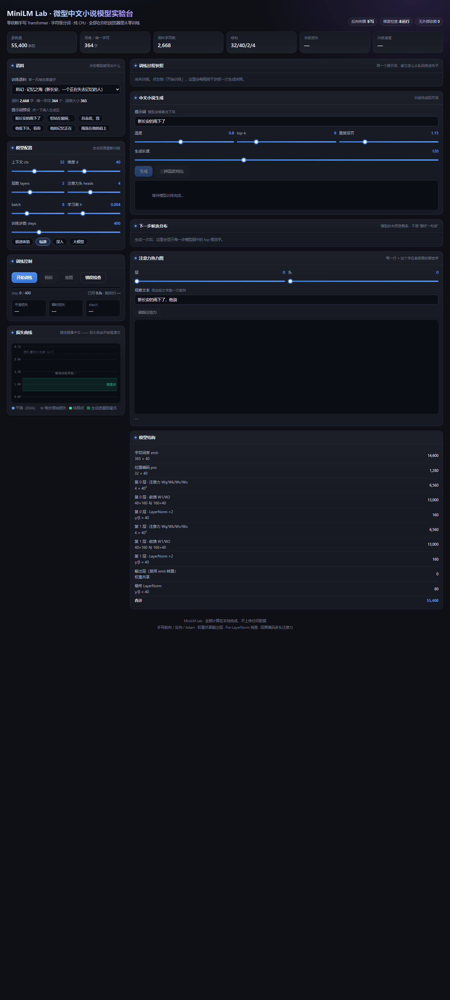
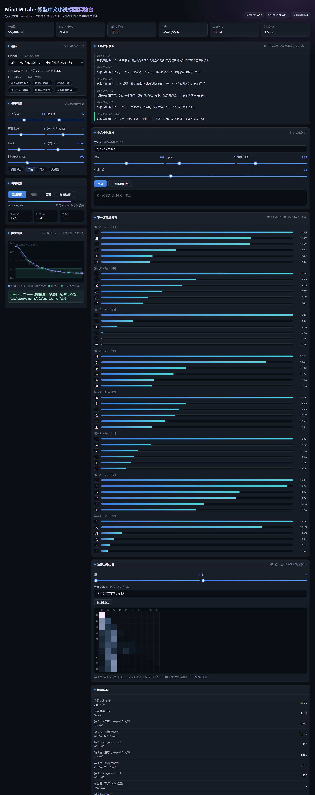

# MiniLM Lab · 微型中文小说模型实验台

一个**从零手写**的字符级 Transformer 语言模型 + 一个**在浏览器里就能训练它**的交互实验台。
零依赖、纯 CPU、不上传任何数据。

> 目标来自最初的需求：**能跑在 CPU、手机、嵌入式设备上的本地小模型**。
> 这个项目把它做成了一个"看得见内部"的教学实验台 ——
> 你能亲手调参、看损失曲线、看注意力热力图，最重要的是：
> **亲眼看着一堆随机数字变成会写中文小说的模型。**





---

## 定位说明（2026-09 实测后补充）

**这个实验台是「教学可视化」工具，不是训练平台。** 它的天花板上限是十万参数级。

本机实测（Intel N100）：

| 项 | 实测 |
|---|---|
| 本项目的 JS 手写矩阵乘法 | **0.56 GFLOPS** |
| 同一台机器上的 NumPy / OpenBLAS | **69.2 GFLOPS**（差 **124 倍**） |
| 训一个 5000 万参数模型（浏览器） | **约 17 年** |
| 同一个模型（租 RTX 3090） | **约 3 小时**（¥4） |

所以：**想看得见原理 —— 用它；想真正产出会写小说的模型 —— 走 Python + PyTorch。**

**执行路线以 [`docs/PRD_NOVEL_MODEL_LEARNING_V1.md`](docs/PRD_NOVEL_MODEL_LEARNING_V1.md) 为准**
（配套清单 [`docs/TODO_NOVEL_MODEL_LEARNING_V1.md`](docs/TODO_NOVEL_MODEL_LEARNING_V1.md)）。
`小模型写小说_从零学习方案_2026-09.md` 已降级为**技术背景材料**，仅保留设计依据与实测数据，不作为排期或验收依据。

---

## 路线与进展

目标有三件事：**做出一个会写小说的小模型、学透大模型原理、把过程分享出去**。

- 路线图与优先级：`小模型写小说_从零学习方案_2026-09.md`（L0 平移验证 → L3 数据工程 → L6 结构化解码 → L5 对齐）
- 实验日志与内容素材库：`LOG.md`
- **当前位置**：JS 实验台完成并全量验证；**L0 已通过**（2026-09-13）——PyTorch 复刻版与手写 JS 版
  在多种子对比下不可区分（损失曲线偏差 ≤0.030，Top-1 均值差在种子噪声内，见 `py/align_report.md`）；
  正在做 **L3 数据工程**：语料已达 **1126 部 / 2793 万字**（公版 + 开放许可，见 `data/sources.json`），
  2026-09-14 起用**按作品切分**的 `data/splits/{train,val,test}.txt` 替代旧的「整桶连续 90/10」口径
  （旧切分会把同一部作品劈进 train 和 test；新口径 train/val/test 不跨作品，见 `py/data/build_splits.py`、
  `train.py --splits`）。**下一步**：把 `sweep_data_scale.py` / `eval_story.py` 迁到新口径，再启动
  「大纲 → 正文」配对数据。

---

## 快速开始

**方式一：直接打开单文件（推荐）**

双击 `index.html`。它是一个完全自包含的单文件（~79 KB），
不依赖任何外部文件、不需要服务器、不需要联网。
拷到手机上用浏览器打开也能跑。

**方式二：从源码构建**

```bash
node build.js      # 把 minilm.js + corpus.js 内联进 ui-src.html → index.html
```

**方式三：命令行训练（不给浏览器用的纯测试路径）**

```bash
node test.js --grad      # 只做梯度检查，验证反向传播数学是否正确
node test.js --quick     # 快速训练（200 步）
node test.js             # 完整训练（三段语料各 700 步）
node test_novel.js       # 中文小说生成能力测试，产出 report_evidence.md
```

---

## 文件说明

| 文件 | 作用 |
|---|---|
| `index.html` | **最终交付物**。单文件自包含的交互实验台（由 build.js 生成，勿手工改） |
| `ui-src.html` | 实验台的**源码外壳**（含全部 CSS / UI 逻辑），改界面改这个 |
| `minilm.js` | 核心库：手写的前向 / 反向 / Adam / 采样 / 分词器。**唯一真源** |
| `corpus.js` | 三段原创中文小说语料（科幻 / 武侠 / 都市），各约 2100~2700 字 |
| `build.js` | 打包脚本：`ui-src.html` + `minilm.js` + `corpus.js` → `index.html` |
| `小模型写小说_从零学习方案_2026-09.md` | **路线图**：L0–L7 分级计划、技术栈边界实测、里程碑与风险 |
| `LOG.md` | **旅程日志**：每个实验做了什么、数字是多少、意外发现是什么。内容素材库 |
| `py/` | **Python + PyTorch 训练链路**（L0 起的真源）：复刻版 + 多种子对齐验证（已通过） |
| `py/data/fetch_corpus.py` | **公版语料抓取管线**：Gutenberg / GitHub 古典文库 / 维基文库 → 清洗 → 分桶 → `corpus.json` |
| `py/data/prepare.py` | 逐作品 manifest 与 train/val/test split 审计（`data/manifest.jsonl`、`data/split_audit.json`） |
| `py/data/build_splits.py` | **按作品整篇切分**语料 → `data/splits/{train,val,test}.txt`（train/val/test 不跨作品，杜绝同作品泄漏） |
| `py/sweep_worksplit.py` | **数据量扫描 + 收敛曲线 + 多种子误差棒**（吃 `data/splits/`，模型与 trigram 同口径记 NLL/PPL；`--tag` 并列多套主体，`--leak_probe` 只换留出集的受控 A/B） |
| `py/compare_cfg.py` | **两组同协议、只换模型主体**的结果逐格对照（ΔTop-1 / ΔNLL + 参数量分账），回答"差距是容量还是结构" |
| `py/compare_ctx.py` | **多组同协议、只换上下文长度**的结果对照：逐格 ΔTop-1 / ΔTop-5 / ΔNLL 边距 + 基线自身漂移 + compute-matched 核对 |
| `py/compare_budget.py` | **预算给足**对照：固定 ctx/档位、只改步数的边距 × 步数表 + 曲线图（`docs/img/budget_steps.png`） |
| `py/plot_ctx_mechanism.py` | 机制图：把各实验臂按**训练步数**对齐画出，用来分辨"上下文效应"与"步数效应"（`docs/img/ctx_mechanism.png`） |
| `py/sweep_data_scale.py` | 早期数据量扫描（桶内**连续** 90/10 切分，**含同作品泄漏**，已被上一个脚本取代，留作历史口径） |
| `py/sweep_report.py` | 把各批次 `sweep_*.json` 合并成一张对比表 + 折线图 |
| `data/` | 语料审计产物：`sources.json`（**1126 部**作品的来源/许可/哈希）、`manifest.jsonl`、`split_report.json`、`splits/` |
| `docs/experiments/` | 每个实验一份记录（问题/假设/唯一变量/结果/失败样本/结论边界/复现命令） |
| `eval/` | **评估协议与基线**：`protocol.js`（位置/上文/指标的唯一定定义）、`baselines.js`（unigram/bigram/trigram 基线）、`metrics.js`（重复率/重合度/OOV）、`fixtures/`（手算样本） |
| `中文小说生成测试报告.md` | **中文小说生成能力测试报告**（结论、数据、局限） |
| `report_evidence.md` | 上述报告的原始证据（由 `test_novel.js` 自动生成） |
| `test.js` | 命令行验证：梯度检查 + 训练 + 生成 |
| `test_novel.js` | 中文小说生成测试，自动生成 `report_evidence.md`（支持 `--seed` / `--out`） |
| `test_rng.js` | 随机流验证：可复现性、三条流隔离（生成不影响训练批次）、状态存恢复（11 项） |
| `smoke.js` | 冒烟测试：校验构建产物零外部依赖、内联代码可执行、API 全部可用 |
| `uidom.js` | UI 端到端测试：用最小 DOM 桩把 UI 真跑一遍（33 项断言） |
| `docs/img/` | README 截图（由 `dev/shot.js` 无头浏览器自动生成） |
| `dev/` | 调试期的诊断脚本与历史输出（含 `shot.js` 无头截图工具），正常使用不需要 |

改完 `ui-src.html` 或 `minilm.js` 之后记得跑一遍：

```bash
node build.js && node smoke.js && node uidom.js && node test_rng.js
```

---

## 语料：公版中文小说 · 2793 万字 / 1126 部作品

`corpus.js` 里那三段语料是手写的（合计 7360 字），只够让实验台跑起来。
真正训练用的语料分三个层级（数字都由脚本生成、可复查）：

| 产物 | 规模 | 用途 |
|---|---|---|
| `data/sources.json` + `data/processed/<桶>/*.txt` | **1126 部 / 2793 万字**（逐作品全文，**未截断**） | 审计真源；`build_splits.py` 从这里取正文 |
| `data/splits/{train,val,test}.txt` | train 899 部 / 2065 万字 · val 110 部 / 293 万字 · test 117 部 / 436 万字 | **无泄漏实验（推荐口径）**：train/val/test 不跨作品 |
| `py/data/corpus.json` | **918 万字**（按桶均分截断，每桶上限 200 万字） | 早期扫描与 JS 对齐口径（桶内连续 90/10，**有同作品泄漏**） |

来源与许可（逐作品清单见 `data/sources.json`；判定标准见 `docs/DATA_CANDIDATES.md`）：

- **Project Gutenberg** 中文公版图书（`gutenberg.org`，Public Domain）
- **GitHub `xp44mm/hanchuancaolu`** 中国古典文学原文（Public Domain）
- **中文维基文库** 清末「科学小说」与公版白话小说（CC BY-SA 4.0 / PD）
- ⚠️ **`adam89/TinyStoriesChinese`**（CDLA-Sharing-1.0，`story` 桶）—— 许可是干净的，
  但它是 **GPT 生成 + 机器翻译的合成文本**，不是自然汉语。
- ❌ **`asd567557275/chinese_novel`**（`scifi` 桶内 1 部）—— **现代网文，上传者自贴 CC BY 4.0
  但并非权利人，标签不覆盖原著版权**。按项目标准**不应视为许可干净**；
  它同时占了 `scifi` 训练区的 **96.4%**，使该桶失去作证据的资格。**保留数据、仅作本地学习与跨域对照**（详见下）。

| 桶 | 作品数 | 清洗后字数 | 代表作品 | 可作证据？ |
|---|---|---|---|---|
| `scifi` 科幻 · 清末科学小说 + 现代幻想 | 5 | 180 万 | 月界旅行、猫城记、新纪元、电世界 | ❌ **只作跨域对照**（见下） |
| `wuxia` 武侠 · 侠义公案 | 23 | 808 万 | 水浒传、三侠五义、儿女英雄传、荡寇志、施公案 | ✅ |
| `urban` 都市 · 世情谴责 | 26 | 543 万 | 官场现形记、二十年目睹之怪现状、老残游记、孽海花 | ✅ |
| `gudian` 古典 · 神魔笔记 | 37 | 1125 万 | 红楼梦、西游记、三国演义、封神演义、聊斋志异、三言二拍 | ✅ |
| `story` 短故事 · 简单现代汉语 | 1000 | 27 万 | 合成短篇（单篇约 253 字，**机翻模板文本**） | ⚠️ **只作工程样本** |
| `xiandai` 现代 · 民国新文学公版 | 35 | 110 万 | 鲁迅、老舍、郁达夫、萧红 | ✅ **现代白话主力桶** |

> ⚠️ **两个桶不可按字面读（2026-09-14 实测，详见 `docs/experiments/2026-09-14-worksplit-nll-converge.md` §9.1–9.3）**
> - **`scifi` 是跨域对照，不是科幻域泛化**：池里 92.6% 的字数来自**一部现代网文**
>   （HF 上传、许可存疑），而它唯一的留出作品《貓城記》是 **1932 年**作品。
>   且它是**单部作品**，按「按作品留出」无法既训练又留出 → **不具备独立成桶的资格**。
> - **`story` 是合成模板文本**：1000 部全部来自 `TinyStoriesChinese`，留出是 100 个约 254 字的碎片。
>   拿它的 Top-1/NLL 与公版自然文本桶**并列排名没有意义**。
> - 结论：**只有 `gudian`/`wuxia`/`urban` 三个公版自然文本桶可作证据。**

处理链路要点（踩坑记录见 `docs/experiments/2026-09-13-public-domain-corpus.md`）：
去 Gutenberg 头尾 → 硬换行重排回自然段 → 标点归一 → 繁转简（opencc）→
字符白名单（丢弃版式残渣）→ **跨源按标题去重取最长版本** → 按桶**均分截断**
（保证每部作品都有代表，而不是只剩最长的两三部）。

注意**截断只发生在 `corpus.json` 这一层**：`data/splits/` 用的是 `data/processed/`
里每部作品的全文，所以它的总字数（2793 万字）比 `corpus.json`（918 万字）大得多。

```bash
python py/data/fetch_corpus.py --list-sources            # 先看清单，不下载
python py/data/fetch_corpus.py --max-chars 2000000       # 抓取 + 清洗 + 分桶
python py/data/prepare.py --split                        # 逐作品 manifest + split 审计
```

---

## 这个模型里有什么

全部手写，没有调用任何深度学习库：

- 字符级分词器（词表就是语料里出现过的所有汉字）
- Token Embedding + 可学习位置编码
- 因果多头自注意力（Causal Multi-Head Self-Attention）
- 前馈网络（GELU，tanh 近似）
- Pre-LayerNorm 残差结构
- 权重共享输出层（Weight Tying，输出层复用 Embedding 的转置）
- **手写反向传播** —— 一直推到每一个矩阵乘法
- Adam 优化器 + 梯度裁剪 + 线性 warmup + 余弦衰减
- top-k / 温度 / 重复惩罚采样
- **三条互相独立的确定性随机流**（初始化 / 训练批次 / 生成采样）——
  固定种子即可完全复现；中途多生成几次快照也不会改变后续训练批次
- 注意力矩阵导出（给热力图用）

默认配置 `ctx=32 d=40 layers=2 heads=4` 时约 **5.5 万参数**，
在 Node 单线程下约 **2~3 步/秒**，浏览器里同量级。

---

## 实验台能做什么

| 面板 | 看什么 |
|---|---|
| **语料** | 三段内置语料 + 自定义粘贴。语料的"集中度"直接决定模型能写出什么 |
| **模型配置** | 四档预设（极速/标准/深入/大模型）+ 每个超参的滑块 |
| **训练控制** | 进度、实时损失、step/s、剩余时间 |
| **损失曲线** | 原始损失 + EMA 平滑 + 快照点 + 本次实测的**观察区间**色带（非通用阈值） |
| **训练过程快照** | 同一个提示词，看它从乱码长成句子 |
| **中文小说生成** | 温度 / top-k / 重复惩罚 / 长度可调，支持三种温度横向对比 |
| **下一步候选分布** | 每一步模型眼中的 top 候选字 —— 模型的本质是概率 |
| **注意力热力图** | 逐层逐头，看"每个字在注意前面的哪些字" |
| **梯度检查** | 有限差分对比解析梯度，现场验证手写反向传播是否正确 |

---

## 一个反直觉的实测结论

训练到 loss 很低并不等于生成得更好。在本项目的实测里：

| 阶段 | 交叉熵损失 | 表现 |
|---|---|---|
| 乱码期 | > 4.0 | 只能吐随机汉字 |
| 成词期 | 3.0 ~ 4.0 | 出现「的」「了」「他」，但没有句子结构 |
| **观察区间** | **0.8 ~ 2.5** | **能写出通顺且有风格的中文句子** |
| 背诵期 | < 0.8 | 开始逐字背语料；采样稍有偏离就碎成拼接片段 |

原因是：语料只有 2000 多字、模型有 5 万多参数，
训练够久它就会把语料**记住**而不是**学会**。

> **这些区间是一次实测的观察结果，不是通用阈值。**
> 它只在「2668 字语料 / 5.5 万参数 / 400 步」这组特定条件下成立，
> 换语料、换规模、换步数都会整体移动。
> 实验台的损失曲线上画了这条色带作为参考，
> 但要不要停，请以右侧的实际生成输出判断，不要只看 loss 数值。
> （依据 `docs/PRD_...` P0：甜蜜点仅保留为历史观察，不得作为自动停止依据。）

这个现象在教学上比"损失越低越好"更有价值。

---

## 验证状态

| 测试 | 结果 |
|---|---|
| 梯度检查（float64 有限差分，逐参数分量） | ✓ 688/688 分量通过，显著梯度最大相对误差 ~1e-6 |
| 冒烟测试（`smoke.js`） | ✓ 23/23 —— 单文件零外部依赖、内联代码可执行、API 全部可用 |
| UI 端到端（`uidom.js`） | ✓ 41/41 —— init 装配、训练循环、快照、生成、注意力、token 映射、梯度检查全通 |
| 随机流（`test_rng.js`） | ✓ 11/11 —— 可复现、种子有效、三条流隔离、状态存恢复 |
| 指标自测（`eval/test_eval.js`） | ✓ 58/58 —— 平滑概率、回退、重复率、重合度、OOV、评估协议均对上手算值 |
| 中文小说生成（`test_novel.js`） | 留出集 Top-1 **20%~40%** —— 但**没跑赢 trigram 基线**，详见下一节 |

### ⚠️ 但模型打不过 trigram 基线

下面这张表比上面任何一行都重要。三条基线**只在训练集上拟合**，
并在**与模型完全相同的留出集位置、相同的可见上文长度、相同词表**上评估
（共用 `eval/protocol.js`，位置不可能对不上）。seed=42 / 400 步实测：

| 语料 | 模型 Top-1 | unigram | bigram | **trigram** | 模型 − trigram | 模型 NLL | trigram NLL |
|---|---|---|---|---|---|---|---|
| 科幻 · 记忆之海 | **34.0%** | 8.6% | 34.0% | **41.4%** | **−7.4 pt** | 3.516 | 3.603 |
| 武侠 · 剑雨楼 | **20.3%** | 7.3% | 21.9% | **22.9%** | **−2.6 pt** | **5.652** | 4.901 |
| 都市 · 深夜面馆 | **40.2%** | 11.7% | 37.9% | **41.0%** | **−0.8 pt** | 3.943 | 3.666 |

**模型 Top-1 没有一处显著超过 trigram**；武侠语料的留出集困惑度（284.9）
甚至比"按字频瞎猜"（165.4）还差。原因不是 bug，是**过拟合**：
5.5 万参数记 1,900~2,400 个训练字（约 29 参数/字），训练 loss 压到 1.3~1.6，
留出集 NLL 却是 3.5~5.7。

生成文本倒是没有在复读训练集：8-gram 与训练集重合率 ≈ 0%，
最长公共子串仅 6~9 字，distinct-2 有 0.82~0.87 —— 它在**重组**，不是在回放。

> **早期版本写的是"Top-1 是随机猜测的 73~132 倍"，这个说法已于 2026-09-13 修正。**
> 随机猜测（1/V）只是数学下限，不是及格线。真正的及格线是 n-gram 统计模型。

详细分析与局限见 `中文小说生成测试报告.md`；原始证据见 `report_evidence.md` 与
`eval/baselines_report.md`。

> **同一问题的第二轮（Python 链路，613 万字公版语料）**：把训练语料从 7360 字扩到
> **613 万字（833 倍）**后重跑，结论是**仍然没有在留出集 Top-1 上整体超过 trigram**，
> 但上一轮"数据变多模型反而更差"的部分是**评测步长 bug + 训练不足**造成的假象。
> 修正协议的完整结果见 `docs/experiments/2026-09-13-sweep-data-scale.md`。
> ⚠️ 这一轮的留出集是"桶内连续 90/10"，**有同作品泄漏**，结论已被第三轮取代。

> **第三轮（现行结论 · 2026-09-14）**：语料扩到 **2793 万字 / 1126 部**并改为
> **按作品整篇切分**（`data/splits/`，train/val/test 不跨作品），同时补上
> **留出集 NLL**、**3 个种子**、**训到接近收敛**（3 epoch）。三点变化：
>
> 1. **NLL：从 1 万字起，模型在全部 5 个桶上胜过 trigram**（−0.64 ~ −1.19 nat）。
>    交叉点在 2,000~10,000 字之间（注：该"档位"里混着**训练步数**这个变量，见第五轮）。
> 2. **Top-1：混合**。`wuxia` 在 1 万~100 万字四档**全部胜出**；
>    `urban` 两胜；`scifi`/`gudian`/`story` 仍负（`story` −1.9~−10.4pt 最多）。
>    ⚠️ **但 `scifi` 与 `story` 两桶有构造陷阱，不能按字面读**（详见下面的语料章节）：
>    `scifi` 训练区 96.4% 是一部现代网文、留出却是 1932 年作品（跨域）；
>    `story` 是机翻合成模板文本。**可用作证据的只有 `gudian`/`wuxia`/`urban` 三个自然文本桶。**
> 3. **上一轮"模型全负"主要是留出集泄漏造成的**。受控 A/B（同一训练、同一步数，
>    只换留出集）：泄漏把 **trigram** 的 Top-1 平均抬高 **+33.5pt**，
>    只把模型抬高 **+6.1pt**（**5.5×**）—— 越"记忆型"的基线被泄漏抬得越多，
>    于是结论被系统性推向"模型打不过基线"。
>
> 完整记录见 `docs/experiments/2026-09-14-worksplit-nll-converge.md`，
> 图见 `docs/img/worksplit_scaling.png` 与 `worksplit_converge.png`。
>
> **第四轮（同日 · 容量对照）**：把 Transformer 主体放大 **4.95×**（40,800 → 202,112 参数），
> 数据 / 步数 / 种子 / 评测协议**全部不变**。结论：**容量只解释一小部分**——
> ≥5 万字档 Top-1 边距一致改善 **+0.3 ~ +3.4pt**，但 **A 级桶最大档仍是 `gudian` −3.5pt / `urban` −0.2pt**，
> **缺口没被填平**；而 **NLL 优势反而继续扩大**（`gudian` 100 万字档 −1.185 → −1.308 nat）。
> 另外 2,000 字档大主体**一致更差**（参数/字数比 ≈305 参数/字，纯记忆区间）→ **加容量必须同时加数据**。
> 代价是 **2.2× 训练耗时**，换回 ~0.8pt，**性价比很低**。完整记录见
> `docs/experiments/2026-09-14-bigbody-capacity-control.md`，逐格对照用 `py/compare_cfg.py`。
>
> **第五轮（同日 · 上下文长度对照）**：`ctx` 32→64（**token 预算对齐**）→
> **≥1 万字的 20 格 Top-1 没有一格变好**；只有 2,000 字档（≈102 epoch 的记忆区间）变好
> （NLL −0.56~−1.15 nat，但那是"记忆容量"不是"泛化"）。
>
> 更关键的是**步数对齐**的归因（20 万字档，7 臂 × 3 桶 × 3 种子）：
> **决定边距的是训练步数（更新次数），不是上下文长度。**
> 同为 293 步时 `ctx32` 与 `ctx64` 的边距**逐格相同**（−1.81 vs −1.83）；
> 步数 586→293→146 时 Top-1 边距 **−0.33 → −1.83 → −3.35**；
> 而同为 586 步时 ctx 32→64→128 只买到 **−0.33 → −0.09 → +0.04**
> ——**在 586 步下模型终于在 Top-1 上与 trigram 打平**。
>
> ⚠️ **方法学警告**：`steps = epochs × 语料量 / (batch × ctx)`，
> 所以"固定 N 个 epoch"= 固定 token，但**步数 ∝ 1/ctx**。
> 直接比 ctx 会**把"优化预算被砍半"误读成"长上下文有害"**（这正是本轮 token 对齐下的表象）。
> 扫 ctx 时必须显式声明对齐的是 token 还是步数，两条都报；另外 `min_steps` 下限
> 也要按 1/ctx 缩，否则下限会静默改变预算。完整记录见
> `docs/experiments/2026-09-14-ctx-length-control.md`，
> 逐格对照用 `py/compare_ctx.py`，机制图见 `docs/img/ctx_mechanism.png`。
>
> **第六轮（同日 · 预算给足）**：固定 ctx=64、20 万字档，只把步数 293 → 1172 → 2344
> （3→12→24 epoch，lr 调度按各自总步数归一）。结论：**Top-1 边距随步数在 3 个桶全部转正**
> （gudian −3.19 → +0.62；逐种子 9/9 格为正）——**缺口确系优化预算问题**，
> 20 万字档的实操答案 ≈12 epoch；但 **NLL 边距在 2344 步明显回升**（urban −0.92 → −0.39）：
> **Top-1（峰值）晚于 NLL（分布）过拟合**，只报 Top-1 会掩盖退化。
> 完整记录见 `docs/experiments/2026-09-14-budget-steps.md`，
> 对照脚本 `py/compare_budget.py`，图 `docs/img/budget_steps.png`。

> 关于梯度检查的一个坑：**必须用 float64**。
> 用 float32 时量化噪声（~1e-6）会淹没小梯度分量，
> 实测最大相对误差会飙到 **1.9**，800 多个分量"失败"——
> 但那是精度问题，不是 bug。项目里为此让 `minilm.js` 支持
> `MINILM_USE_F64` 开关，并让构建产物同时内联 float32/float64 两份实例。

---

## 已知限制

- 语料只有几千字的那个版本（浏览器实验台）会过拟合：模型"会背"而不是"会写"，请控制训练步数。
  Python 链路已备有 **2793 万字公版语料（1126 部作品）**。按作品切分、训到接近收敛后：
  **留出集 NLL 从 1 万字起在全部 5 个桶上胜过 trigram**，但 **Top-1 只在 `wuxia` 上稳定领先**
  —— 模型的分布整体更准，峰值位置不如"只数最近两个字"的统计模型尖。
  详见 `docs/experiments/2026-09-14-worksplit-nll-converge.md`。
- ⚠️ **Top-1 落后不是"模型太小"造成的**：把主体放大 **4.95×**（其余全不变）后，≥5 万字档 Top-1 只改善
  +0.3~+3.4pt，**缺口没被填平**（`gudian` 100 万字档仍 −3.5pt），而 **NLL 优势反而扩大**。
  代价是 **2.2× 训练耗时**。见 `docs/experiments/2026-09-14-bigbody-capacity-control.md`。
- ⚠️ **Top-1 落后也不是"上下文太短"造成的**：`ctx` 32→64（token 预算对齐）后，≥1 万字的
  **20 格 Top-1 没有一格变好**。步数对齐的归因显示 **起作用的是训练步数**：同 293 步时
  `ctx32` 与 `ctx64` 边距**逐格相同**（−1.81 vs −1.83）；步数 586→293→146 时
  Top-1 边距 **−0.33 → −1.83 → −3.35**；**在 586 步下模型终于在 Top-1 上与 trigram 打平（+0.04）**。
  所以下一步该动的是**训练步数 / 学习率调度 / 目标函数 / 解码**，
  以及**先验证"预算给足后缺口是否自然消失"**。见 `docs/experiments/2026-09-14-ctx-length-control.md`。
- ⚠️ **扫超参时 `steps = epochs × 语料量 / (batch × ctx)`**：固定 `epochs` = 固定 token，
  但**步数 ∝ 1/ctx**。直接比 ctx 会把"优化预算被砍半"误读成"长上下文有害"。
  另外 `min_steps` 下限在小档位会静默改变预算，扫 ctx 时要按 1/ctx 缩下限。
- **加容量必须同时加数据**：2,000 字档下大主体在 5/5 桶都更差（参数/字数比 ≈305 参数/字）。
- **留出作品数偏少**：`scifi` 只有 1 部留出作品、`wuxia` 3 部、`urban` 4 部。
  这些桶的方差主要来自"换哪部作品当留出"，不是种子——所以别把它们的绝对值当稳定结论。
- ⚠️ **只有 3 个桶可作证据**：`gudian`/`wuxia`/`urban`（公版自然文本、多部作品）。
  `scifi` 训练区 96.4% 是**一部现代网文**（HF 上传、许可存疑）、留出为 1932 年作品 →
  只作**跨域对照**；`story` 是**机翻合成模板文本** → 只作**工程样本**。
  两者的胜负数字都是**桶构造的产物**，不能用来判断模型能力。
- 语料里混入了 **1 部许可存疑的现代网文**（HF 自贴 CC BY 4.0、上传者非权利人）。
  决定是**保留数据、只做标注**（不删除），但它**已从评测桶降级**——见 `docs/DATA_CANDIDATES.md` §1.2。
- 字符级建模，不认词。中文没有空格，所以"词"要靠模型自己从字序里学。
- 生成是逐字采样的，长文本会不可避免地漂移。
- 没有 KV Cache，每生成一个字都要重算整个上下文。够小所以还能忍。
- 参数量显示与 `paramCount()` 一致；输出层权重共享，不额外计参数。
