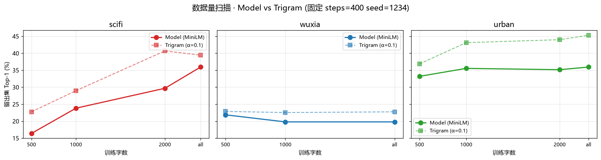

# 数据量扫描：模型需要多少训练字才能超过 trigram？

> **⚠️ 本文档含两轮实验，且两个协议的留出集切法都已被取代，请先读这段。**
>
> **本文档（第一 + 第二轮）用的是「桶内连续 90/10」切分**：在整桶拼接文本上按
> `len*0.9` 连续切一刀当留出。整桶文本是同一批作品的拼接，于是**同一部作品的头进 train、
> 尾巴进 test —— 同作品泄漏**，留出指标被高估。两个协议都受此影响。
>
> **现行口径见 `docs/experiments/2026-09-14-worksplit-nll-converge.md`**：改用
> `py/data/build_splits.py` 产出的**按作品整篇切分**（train/val/test 不跨作品），
> 并由 `py/sweep_worksplit.py` 补上**模型留出集 NLL**、**多种子误差棒**与**收敛曲线**。
> 本文档的数字仍可用于「协议错→结论错」的对照，但**不要**当作当前结论引用。
>
> - **§1–§9 = 第一轮**：7360 字手写语料，训练集 500~2400 字，结论是"12 组配置全部未超过 trigram"。
> - **§10 起 = 第二轮**：语料换成 **613 万字公版语料**，并**修正了基线评测的步长 bug** 后重跑。
>   第一轮的两条说法已被证伪或需重写：①"数据越多模型越差"主要是**评测 bug + 训练不足**的假象；
>   ②"模型全负"在修正协议后并不成立（小-中数据量处模型胜出 4 组）。
> - 第二轮之后语料又被并发工作流重建（**scifi 桶 13.2 万 → 179 万字**，新增 `story` 桶），
>   所以本文档里 **scifi 一列的数字对应的是已不存在的旧语料**，`wuxia/urban/gudian` 三列仍对应现语料。
>
> **结论以 §10 与现行口径文档为准。** 第一轮保留原样，作为"评测协议写错会得出什么结论"的存档。

> 日期：2026-09-13（两轮）。实验文件：`py/sweep_data_scale.py`（**已停止维护**）。

## 1. 问题

在固定模型配置下，MiniLM 需要多少训练字才能超过 trigram 基线？

## 2. 假设

随着训练数据增加，模型 Top-1 会逐渐接近并超过 trigram。

## 3. 唯一变量

| 项目 | 值 | 是否固定 |
|---|---|---|
| 模型配置 | ctx=32 d=40 layers=2 heads=4 ffMul=4 | 是 |
| 参数规模 | ~5.5 万 | 是 |
| 训练步数 | 400 | 是 |
| 优化器 | Adam lr=0.004 + warmup/cosine | 是 |
| 随机种子 | 1234 | 是 |
| 测试集 | 全文最后 10% | 是 |
| 训练数据量 | 500 / 1000 / 2000 / all | **唯一变量** |

## 4. 配置与命令

```bash
python py/sweep_data_scale.py --sizes 500,1000,2000,all --steps 400
```

输出：
- `py/runs/sweep_summary.json`
- `py/runs/sweep_report.md`
- `docs/img/sweep_data_scale.png`

## 5. 结果

### 5.1 科幻 · 记忆之海

| 训练字数 | 留出集字数 | Model Top-1 | Model Top-5 | Trigram Top-1 | Trigram NLL | 胜负 |
|---|---|---|---|---|---|---|
| 500 | 267 | 16.4% | 28.1% | 22.8% | 4.922 | 模型负 |
| 1000 | 267 | 23.8% | 42.2% | 29.0% | 4.616 | 模型负 |
| 2000 | 267 | 29.7% | 55.9% | 40.7% | 4.207 | 模型负 |
| 2401 | 267 | 35.9% | 56.2% | 39.4% | 4.184 | 模型负 |

### 5.2 武侠 · 剑雨楼

| 训练字数 | 留出集字数 | Model Top-1 | Model Top-5 | Trigram Top-1 | Trigram NLL | 胜负 |
|---|---|---|---|---|---|---|
| 500 | 213 | 21.9% | 29.2% | 22.9% | 4.951 | 模型负 |
| 1000 | 213 | 19.8% | 35.9% | 22.5% | 4.880 | 模型负 |
| 1912 | 213 | 19.8% | 30.7% | 22.8% | 4.771 | 模型负 |

### 5.3 都市 · 深夜面馆

| 训练字数 | 留出集字数 | Model Top-1 | Model Top-5 | Trigram Top-1 | Trigram NLL | 胜负 |
|---|---|---|---|---|---|---|
| 500 | 257 | 33.2% | 42.6% | 36.9% | 4.294 | 模型负 |
| 1000 | 257 | 35.5% | 49.6% | 43.1% | 3.985 | 模型负 |
| 2000 | 257 | 35.2% | 50.0% | 44.0% | 3.812 | 模型负 |
| 2310 | 257 | 35.9% | 54.3% | 45.3% | 3.745 | 模型负 |

### 5.4 可视化



## 6. 关键发现

- **模型从未超过 trigram**：在 12 组配置中，MiniLM 的留出集 Top-1 全部低于 trigram。
- **数据量增加有收益，但边际递减**：
  - scifi 从 500→2401 字，模型 Top-1 从 16.4% 提升到 35.9%（+19.5pt）。
  - urban 从 500→2310 字，模型 Top-1 从 33.2% 提升到 35.9%（+2.7pt），已接近饱和。
  - wuxia 提升几乎为 0：数据从 500→1912 字，模型 Top-1 维持在 20% 左右。
- **trigram 也在同步提升**：它不是固定基线，训练字越多，它能记住的 3 字组合越多。

## 7. 失败样本 / 异常

- wuxia 在 1000 字和 1912 字时模型 Top-1 相同（19.8%），说明 400 步训练在该语料上已饱和或陷入局部最优。
- scifi 2000 字时模型 Top-1=29.7%，trigram=40.7%，差距最大（-11pt），可能是因为该数据量下 trigram 已能捕捉较多科幻专有组合，而模型尚未充分学习。

## 8. 结论与边界

**结论**：
> 在本实验范围内（5.5 万参数、400 步、3 个语料、500~2400 字），模型在所有数据量下均未超过 trigram。增加数据能提升模型，但不足以让模型打败只数相邻三字的统计基线。

**边界**：
> - 仅测试了 500~2400 字的数据范围；
> - 仅用一个随机种子；
> - 固定 400 步，未探索「更多数据 + 更多步数」的联合效应；
> - 字符级词表；未与 BPE 子词模型对比；
> - 未调整学习率、模型深度、宽度等超参。

**下一步**：
> 需要继续扩展数据规模（万字、十万字）或增加模型容量，才能判断「模型何时超过 trigram」。当前结果表明：**在小数据字符级场景下，5.5 万参数 Transformer 并不比 trigram 更优。**

## 9. 复现检查清单

- [x] 命令可直接复制运行
- [x] 输出文件路径明确
- [x] 随机种子固定为 1234
- [x] 数据切分方式明确（全文最后 10% 为测试集）
- [x] 失败/异常样本已记录

---

# 第二轮：公版语料 613 万字 + 修正基线协议

> 第一轮的失败样本之一是"基线评测步长写成 1"。修完之后第一轮的结论必须重跑，
> 同时语料也从 7360 字扩到了 613 万字。这一轮才是当前的有效结论。

## 10.1 为什么要重跑

两个**独立**的原因，任何一条都足以让第一轮的结论作废：

1. **语料规模跨了 3 个数量级**：7360 字 → **613 万字**（833×）。
   第一轮自己写的边界是"仅测试了 500~2400 字"，现在这条边界不再成立。
2. **基线评测协议有 bug**（第一轮 §7 只记成了"耗时异常"）：
   - `py/baselines.py` 的 `for_each_position` 步长写成了 **1**（应为 `ctx`=32），
     于是基线在**32 倍**的位置上被评测，且与模型不在同一批位置上比较；
   - `NGram` 给每个上下文分配一个 V 维 float64 数组，在 180 万字语料上约需 **36 GB**
     （实测直接把扫描挂死），叠加 `dist()` 里的 Python 循环，单次基线评测要 13 分钟。

   修复：滑窗改为**每 `ctx` 步一窗**（与 `minilm_torch.holdout_eval` 一致）；
   `NGram` 改**稀疏计数**（`{tgt: count}`，键为整型编码的上下文），`dist()` 只在该步
   临时构造稠密数组并向量化 `np.log`。
   修复后 180 万字语料的基线建表 5.0s、评测 29.2s（**约 32000× 提速**），
   且 `py/tests/test_baselines.py` 用稠密参考实现逐点差分证明**语义完全没变**。

## 10.2 协议

| 项目 | 值 | 是否固定 |
|---|---|---|
| 模型配置 | ctx=32 d=40 layers=2 heads=4 ffMul=4 | 是 |
| 参数规模 | ~5.5 万（`min_freq=3` 裁剪词表后） | 是 |
| 优化器 | Adam lr=0.004 + warmup/cosine + clip 1.0 | 是 |
| batch | 8 | 是 |
| 随机种子 | 1234 | 是 |
| 测试集 | 全文最后 10%（所有配置同一份留出集） | 是 |
| 训练数据量 | 2000 / 10000 / 50000 / 200000 / 1000000 / all | **唯一变量** |
| 词表 | `min_freq=3`（低于 3 次的生僻字映射到 UNK） | 是 |
| trigram | α=0.1（**不挑 α**，避免每个尺寸重搜引入额外随机性） | 是 |

两种步数模式，因为"固定步数"和"固定数据"不能同时固定：

- `fix`：**固定 400 步**。模型 token 预算恒定（400×8×32 = 102,400 token），
  数据变大并不会多看 token —— 相当于"同样多的学习时间，内容变多了"。
- `prop`：**步数随训练字数同比放大**（参考点 20 万字 = 400 步，上限 4000 步）。
  换算下来是**恒定约 0.5 个 epoch**（`steps×8×32 ≈ 0.5 × 训练字数`），
  即"每个字都被看到差不多同样多次"。

## 10.3 命令

```bash
python py/sweep_data_scale.py --sizes 2000,10000,50000,200000,1000000,all --steps 400 --min_freq 3
python py/sweep_data_scale.py --sizes 2000,10000,50000,200000,1000000,all --steps 400 --min_freq 3 --proportional_steps
python py/sweep_report.py     # 合并两批 → runs/sweep_report.md + docs/img/sweep_data_scale.png
```

注：`scifi` 全文只有 13.2 万字，`test_cut=118811`，所以它的 20 万 / 100 万 / all
三个尺寸都被截断到 118811，去重后只剩 4 个点。

## 10.4 结果 · fix 模式（固定 400 步）

| 语料 | 训练字数 | 步数 | Model Top-1 | Trigram Top-1 | 差 | 胜负 |
|---|---|---|---|---|---|---|
| scifi | 2,000 | 400 | 6.9% | 7.2% | −0.3 | 负 |
| scifi | 10,000 | 400 | 6.8% | 7.7% | −0.9 | 负 |
| scifi | 50,000 | 400 | 7.8% | 8.6% | −0.8 | 负 |
| scifi | 118,811 | 400 | 8.6% | 12.9% | −4.3 | 负 |
| wuxia | 2,000 | 400 | 8.1% | 8.7% | −0.6 | 负 |
| wuxia | 10,000 | 400 | **10.5%** | 8.9% | **+1.6** | **胜** |
| wuxia | 50,000 | 400 | **11.1%** | 10.1% | **+1.0** | **胜** |
| wuxia | 200,000 | 400 | 10.8% | 11.4% | −0.6 | 负 |
| wuxia | 1,000,000 | 400 | 11.2% | 15.2% | −4.1 | 负 |
| wuxia | 1,800,037 | 400 | 11.5% | 18.0% | −6.5 | 负 |
| urban | 2,000 | 400 | 6.7% | 7.9% | −1.2 | 负 |
| urban | 10,000 | 400 | **8.9%** | 8.6% | **+0.2** | **胜** |
| urban | 50,000 | 400 | 9.4% | 10.4% | −1.1 | 负 |
| urban | 200,000 | 400 | 8.9% | 15.1% | −6.2 | 负 |
| urban | 1,000,000 | 400 | 10.8% | 20.0% | −9.2 | 负 |
| urban | 1,800,039 | 400 | 9.8% | 21.7% | −11.9 | 负 |
| gudian | 2,000 | 400 | 5.9% | 8.2% | −2.2 | 负 |
| gudian | 10,000 | 400 | **9.7%** | 8.7% | **+1.1** | **胜** |
| gudian | 50,000 | 400 | 9.6% | 9.7% | −0.1 | 负 |
| gudian | 200,000 | 400 | 11.0% | 12.8% | −1.8 | 负 |
| gudian | 1,000,000 | 400 | 9.6% | 15.2% | −5.6 | 负 |
| gudian | 1,800,053 | 400 | 10.0% | 16.5% | −6.5 | 负 |

## 10.5 结果 · prop 模式（≈恒定 0.5 epoch）

| 语料 | 训练字数 | 步数 | Model Top-1 | Model Top-5 | Trigram Top-1 | 差 |
|---|---|---|---|---|---|---|
| scifi | 2,000 | 50 | 7.5% | 12.9% | 7.2% | +0.3 |
| scifi | 10,000 | 50 | 7.5% | 13.1% | 7.7% | −0.2 |
| scifi | 50,000 | 100 | 7.5% | 12.9% | 8.6% | −1.1 |
| scifi | 118,811 | 238 | 7.5% | 14.3% | 12.9% | −5.4 |
| wuxia | 2,000 | 50 | 8.0% | 13.3% | 8.7% | −0.7 |
| wuxia | 10,000 | 50 | 8.5% | 15.6% | 8.9% | −0.4 |
| wuxia | 50,000 | 100 | 8.5% | 15.6% | 10.1% | −1.6 |
| wuxia | 200,000 | 400 | 10.8% | 18.8% | 11.4% | −0.6 |
| wuxia | 1,000,000 | 2,000 | 14.1% | 25.7% | 15.2% | −1.1 |
| wuxia | 1,800,037 | 3,600 | 15.9% | 28.4% | 18.0% | −2.1 |
| urban | 2,000 | 50 | 7.8% | 16.2% | 7.9% | −0.1 |
| urban | 10,000 | 50 | 7.8% | 16.1% | 8.6% | −0.8 |
| urban | 50,000 | 100 | 7.8% | 16.1% | 10.4% | −2.6 |
| urban | 200,000 | 400 | 8.9% | 20.2% | 15.1% | −6.2 |
| urban | 1,000,000 | 2,000 | 16.7% | 32.4% | 20.0% | −3.3 |
| urban | 1,800,039 | 3,600 | 18.4% | 35.1% | 21.7% | −3.3 |
| gudian | 2,000 | 50 | 7.9% | 14.5% | 8.2% | −0.3 |
| gudian | 10,000 | 50 | 8.1% | 14.9% | 8.7% | −0.6 |
| gudian | 50,000 | 100 | 8.1% | 15.1% | 9.7% | −1.6 |
| gudian | 200,000 | 400 | 11.0% | 20.6% | 12.8% | −1.8 |
| gudian | 1,000,000 | 2,000 | 13.8% | 26.2% | 15.2% | −1.4 |
| gudian | 1,800,053 | 3,600 | 14.9% | 28.7% | 16.5% | −1.6 |

### 10.6 可视化


## 10.7 关键发现

1. **"模型全负"在修正协议后不成立。** fix 模式下有 **4 组胜**：
   wuxia 1 万（+1.6pt）、wuxia 5 万（+1.0pt）、urban 1 万（+0.2pt）、gudian 1 万（+1.1pt）。
   但它们都落在**小-中数据量**，且优势只有 0.2~1.6pt —— 单种子下这个量级还不足以说是结论。

2. **fix 模式在大数据量处"模型越输越多"，这不是数据的问题，是 token 预算的问题。**
   urban 从 5 万字的 −1.1pt 一路扩大到 180 万字的 **−11.9pt**，同时模型 Top-1 几乎原地不动
   （6.7% → 9.8%）。原因是模型的可见 token 数被钉死在 102,400，
   数据涨 900 倍而训练量不变 —— 相当于"书变厚了，但只许读同样的页数"。

3. **prop 模式（恒定 0.5 epoch）里模型终于随数据量明显变好**：
   wuxia 8.0% → 15.9%（×2.0）、urban 7.8% → 18.4%（×2.4）、gudian 7.9% → 14.9%（×1.9）。
   这证明"加数据对模型确实有用"，只是**trigram 也在同步变好**
   （8.7% → 18.0% / 7.9% → 21.7% / 8.2% → 16.5%），所以差距没有收敛。

4. **补上步数能追回大部分差距** —— 最大数据量处的对比最清楚：

   | 语料 | fix 差 | prop 差 | 追回 |
   |---|---|---|---|
   | wuxia | −6.5 | −2.1 | 4.4pt |
   | urban | −11.9 | −3.3 | 8.6pt |
   | gudian | −6.5 | −1.6 | 4.9pt |

   所以第一轮"数据越多模型越差"的判断，**主体是训练不足造成的**，而不是"小模型学不动"。

5. **模型的 Top-5 明显高于 trigram 的 Top-1**（28.4%~35.1% vs 16.5%~21.7%）。
   模型的预测分布更"软"、覆盖更宽：它经常把正确答案放在前几名，但**不常放在第一名**。
   trigram 则相反 —— 峰值精度高，但分布窄、回退多。

6. **scifi 是唯一的"数据失效"案例**：数据量从 2000 涨到 13.2 万（66×），
   prop 模式 Top-1 从头到尾卡在 **7.5%**，而 trigram 是 12.9%。
   它的 4 部作品全是清末译文体（如鲁迅译凡尔纳《月界旅行》），
   且只有 13.2 万字 —— 字级分布高度碎片化，模型没有可复用的规律可抓。

## 10.8 结论与边界

**结论**：

> 在 **5.5 万参数**、**约 0.5 epoch** 的训练预算下，把公版语料从 7360 字扩到 **613 万字（833×）**，
> 字符级 Transformer 在留出集 **Top-1 上仍未能超过 trigram**（4 个桶的最大数据量处落后 1.6~5.4pt）。
> 但"落后多少"主要由**给模型多少步**决定，而不是由数据量决定：
> 同一份语料，固定 400 步时 urban 落后 11.9pt，换成等 epoch 后只剩 3.3pt。
> 也就是说 —— **数据不是瓶颈，训练预算才是；而即便如此，trigram 依然领先。**

**边界（这些限定词不能省）**：

> - prop 模式封顶 3600 步 ≈ **0.5 epoch**，模型**远未收敛**。
>   本实验测的是"小预算下的表现"，不是这个模型的**容量上限**。要谈上限，必须训到收敛。
> - **单种子**（1234），没有误差棒。fix 模式那 4 个 0.2~1.6pt 的"胜"落在噪声量级上，不足以定论。
> - 只比了 **Top-1 / Top-5**。模型的**留出集 NLL 没有被记录**（只记了训练 loss），
>   所以无法回答"模型的概率预测是否比 trigram 更准"——这是下一步最该补的一项。
> - 字符级词表；未与 BPE 子词模型对比；未调学习率、深度、宽度。
> - 语料全部是**明清白话 / 晚清译文**，与现代小说语体有明显差距，
>   不能据此推断"模型写不了现代小说"。
> - `scifi` 桶只有 13.2 万字，跨桶比较时权重不同。
> - trigram 的 α 固定 0.1 不调参；若给 trigram 调 α，它可能更强。

**下一步（按优先级）**：

> 1. 记录**模型的留出集 NLL / 困惑度**，与 trigram 正面对比（当前缺失的最关键数字）；
> 2. 训到**收敛**（多个 epoch）再看差距，确认当前差距有多少是预算造成的；
> 3. 加**多个种子**，给 fix 模式那几个 1pt 级的"胜"配上误差棒。

## 10.9 复现检查清单

- [x] 命令可直接复制运行
- [x] 输出文件路径明确（`py/runs/sweep_*.json`、`py/runs/sweep_report.md`）
- [x] 随机种子固定为 1234
- [x] 数据切分方式明确（全文最后 10% 为测试集，所有配置同一份）
- [x] 模型与基线**在同一批评测位置**上比较（步长均为 `ctx`）
- [x] 稀疏基线实现已用稠密参考实现逐点差分验证（`py/tests/test_baselines.py`，9 项全过）
- [x] 失败/异常样本已记录（见 10.1 的两条 bug）
